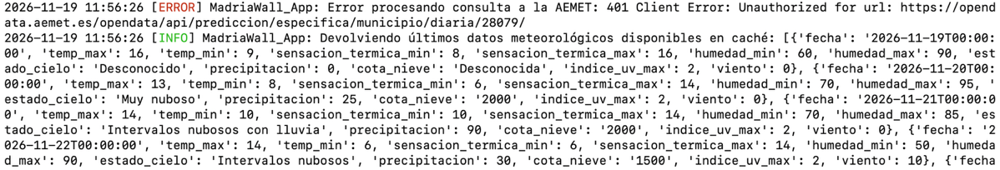
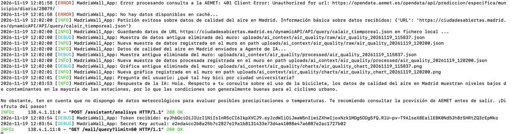
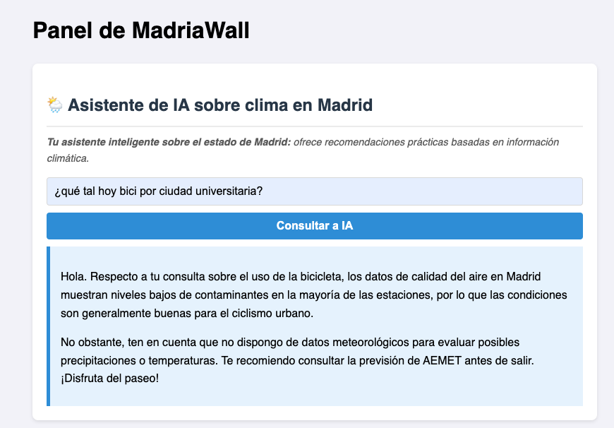
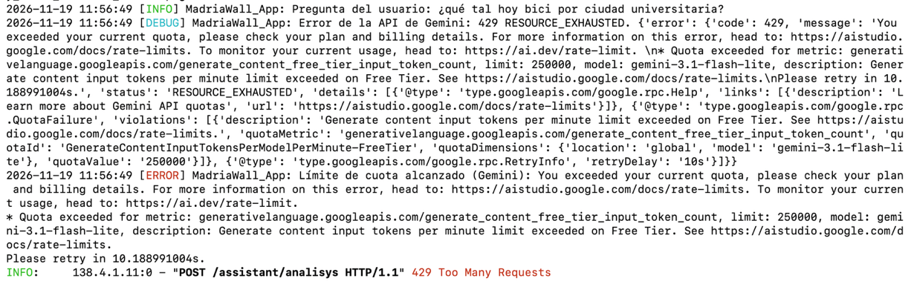
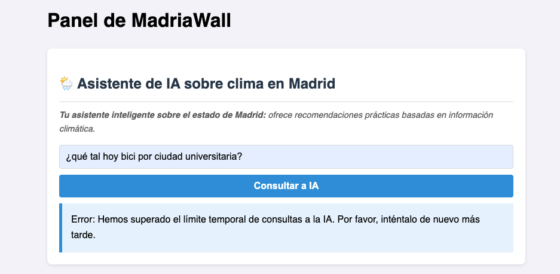
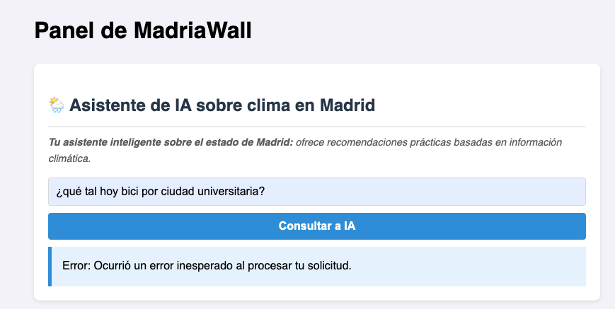
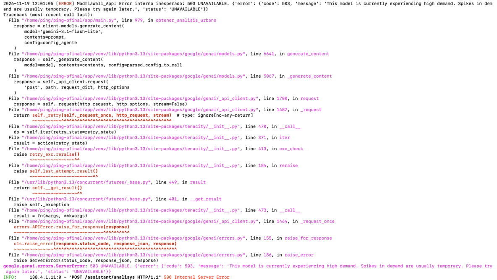

# Instrucciones para resolver el proyecto (MadriaWall)

Esta guía te explica, paso a paso, cómo poner en marcha la aplicación
**MadriaWall** (un asistente urbano inteligente de Madrid y un muro de
contenido digital) en el **servidor de la asignatura**.

> Consejo: ejecuta los comandos **de uno en uno**. Después de cada uno, lee la
> salida de la terminal antes de pasar al siguiente.

---

## Índice

- [1. Antes de empezar (requisitos)](#1-antes-de-empezar-requisitos)
- [2. Obtener el código](#2-obtener-el-código)
- [3. Crear y activar el entorno virtual de Python](#3-crear-y-activar-el-entorno-virtual-de-python)
- [4. Instalar las dependencias](#4-instalar-las-dependencias)
- [5. Conseguir las API Keys y el secreto](#5-conseguir-las-api-keys-y-el-secreto)
- [6. Configurar el fichero `.env`](#6-configurar-el-fichero-env)
- [7. Configurar el fichero `config.json`](#7-configurar-el-fichero-configjson)
- [8. Servir el contenido estático](#8-servir-el-contenido-estático)
- [9. Arrancar la aplicación (backend)](#9-arrancar-la-aplicación-backend)
- [10. Comprobar que todo funciona](#10-comprobar-que-todo-funciona)
- [11. Fuentes de datos abiertas](#11-fuentes-de-datos-abiertas)
- [12. Conectarse al servidor con SSH](#12-conectarse-al-servidor-con-ssh)
- [13. Problemas frecuentes (troubleshooting)](#13-problemas-frecuentes-troubleshooting)

---

## 1. Antes de empezar (requisitos)

Antes de nada, asegúrate de que:

- Tienes **acceso al servidor** mediante SSH usando la **clave** que te han
  proporcionado los profesores (la conexión **no** usa contraseña). Si nunca has
  usado SSH, consulta el tutorial paso a paso en la sección
  **"12. Conectarse al servidor con SSH"**, al final de este documento.
- Has copiado tu **fichero de clave SSH** en tu ordenador del laboratorio (ver
  más abajo, **"Obtener tu clave privada"**).
- En el servidor ya hay instalados **Python 3.10 o superior**, **MongoDB** y
  **Apache** (de esto se encargan los profesores; tú **no** necesitas permisos
  de administrador/root).
- Sabes cuál es la **dirección IP del servidor**. En esta guía la escribiremos
  como `<IP_SERVIDOR>`; sustitúyela por la que te hayan indicado. El servidor que
  se usa en el proyecto final es el mismo que el que se ha usado en la Actividad 4 y
  Laboratorio 4 del bloque de Telemática y Servicios. Recuerda que se arranca usando
  el script `servidor_nube.py`, que está disponible en Moodle.

### Obtener tu clave privada

Tu clave privada está en el ordenador del laboratorio de Telemática y Servicios,
en la carpeta `/lab/ping/`. **El fichero de clave se llama exactamente igual que
tu nombre de usuario**, es decir, el mismo usuario con el que inicias sesión en
el ordenador del laboratorio. Si no lo recuerdas, puedes consultarlo con:

```bash
whoami
```

Sitúate (con `cd`) en la carpeta donde quieras guardar la clave y cópiala allí:

```bash
cp /lab/ping/<nombre_de_usuario> .
```

> Sustituye `<nombre_de_usuario>` por tu nombre de usuario del laboratorio. El
> `.` final significa «la carpeta actual». El fichero copiado se llamará también
> `<nombre_de_usuario>`, y su ruta es la `<ruta_a_tu_clave>` que se usa en los
> comandos siguientes. En el tutorial de la sección 12 se propone guardarla en
> `~/ping-proyecto-final`.

### Conectarte al servidor

Para entrar al servidor desde tu ordenador del laboratorio de Telemática y
Servicios (si aún no estás dentro), usa tu clave SSH:

```bash
ssh -i <ruta_a_tu_clave> ping@<IP_SERVIDOR>
```

> Sustituye `<ruta_a_tu_clave>` por la ruta al fichero de clave que copiaste en
> el paso anterior (por ejemplo, `~/ping-proyecto-final/<nombre_de_usuario>`).
> Si es la primera vez que te conectas o tienes dudas, consulta el tutorial
> paso a paso en la sección **"Conectarse al servidor con SSH"**, al final de
> este documento.

---

## 2. Obtener el código

> **Dónde estás:** este paso y todos los siguientes se hacen **dentro del
> servidor** (es decir, después de haberte conectado por SSH). No los ejecutes
> en tu ordenador del laboratorio de Telemática y Servicios. Si aún no estás
> conectado, revisa la sección
> **"12. Conectarse al servidor con SSH"**.

"Clonar" significa **descargar una copia del repositorio** (el proyecto) en el
servidor.

```bash
git clone https://github.com/oaraque/ping-pfinal
```

> Esto descarga el proyecto y crea una carpeta nueva llamada `ping-pfinal` con
> todos sus ficheros, **en el servidor**.

Ahora **entra en la carpeta `app`**, que es donde está la aplicación. El comando
`cd` ("change directory") sirve para moverse entre carpetas:

```bash
cd ping-pfinal/app
```

> Si el nombre de la carpeta clonada es distinto, ajústalo. Para ver en qué
> carpeta estás, usa `pwd`; para ver qué ficheros hay, usa `ls`.

---

## 3. Crear y activar el entorno virtual de Python

Un **entorno virtual** es una "caja aislada" donde se instalan las librerías de
Python de este proyecto, sin afectar al resto del sistema.

Créalo (solo hay que hacerlo **una vez**):

```bash
python3 -m venv venv
```

> Esto crea una carpeta llamada `venv` con el entorno virtual.

Actívalo (hay que hacerlo **cada vez** que abras una terminal nueva para
trabajar en el proyecto):

```bash
source venv/bin/activate
```

> **¿Cómo sé que está activado?** Verás que al principio del prompt aparece
> `(venv)`, por ejemplo: `(venv) ping@servidor:~/ping-pfinal/app$`.
> Si no aparece, el entorno no está activado y los siguientes pasos fallarán.
>
> Para desactivarlo más tarde, escribe `deactivate`.

---

## 4. Instalar las dependencias

Las "dependencias" son las librerías que la aplicación necesita para funcionar.
Están listadas en el fichero `requirements.txt` y se instalan con:

```bash
pip install -r requirements.txt
```

> Asegúrate de que el entorno virtual está activado (debe verse `(venv)`) antes
> de ejecutar este comando. La instalación puede tardar un poco; es normal.

---

## 5. Conseguir las API Keys y el secreto

La aplicación necesita **tres valores secretos**. Consíguelos antes de seguir:

1. **API Key de AEMET** (datos meteorológicos):
   Solicita tu clave indicando tu correo electrónico en
   [el formulario de obtención de API Key de AEMET](https://opendata.aemet.es/centrodedescargas/obtencionAPIKey).
   Recibirás la clave por correo.

2. **API Key de Gemini** (inteligencia artificial):
   Obtén una clave desde
   [Google AI Studio](https://aistudio.google.com/).

3. **SECRET_KEY** (un secreto para firmar los tokens de inicio de sesión):
   genera uno seguro ejecutando en la terminal:

   ```bash
   python -c "import secrets; print(secrets.token_hex(32))"
   ```

   > Esto imprime una cadena larga de 64 caracteres. **Cópiala**: la usarás en
   > el paso siguiente.

Guarda los tres valores a mano; los vas a necesitar justo ahora.

---

## 6. Configurar el fichero `.env`

El fichero `.env` guarda los valores secretos como **variables de entorno**.
Edítalo con el editor de texto `nano`:

```bash
nano .env
```

Dentro del editor, escribe (o completa) estas tres líneas, pegando tus valores
después del signo `=` (sin espacios ni comillas):

```bash
API_KEY_AEMET=aqui_tu_clave_de_aemet
API_KEY_GEMINI=aqui_tu_clave_de_gemini
SECRET_KEY=aqui_tu_secret_key_generada
```

Para **guardar y salir de nano**:

1. Pulsa `Ctrl` + `O` y luego `Enter` (guarda los cambios).
2. Pulsa `Ctrl` + `X` (cierra el editor).


---

## 7. Configurar el fichero `config.json`

Este fichero define el **comportamiento del asistente de IA** y los datos de
conexión a la **base de datos MongoDB**.

Ábrelo con nano:

```bash
nano config.json
```

Debe tener esta estructura:

```json
{
  "ai_agent": {
    "system_instruction": "Escribe aquí las instrucciones de tu asistente de IA"
  },
  "database": {
    "user": "admin",
    "password": "admin",
    "ip": "localhost",
    "port": "27017"
  }
}
```

Explicación de los campos:

- `ai_agent.system_instruction`: define el "rol" y las instrucciones del
  asistente de IA particular. Puedes elegir el tema sobre el que quieres que te
  ayude; después, al hacerle preguntas relacionadas con ese tema, el asistente
  orientará sus respuestas según las instrucciones que hayas configurado.
- `database`: datos para conectar con MongoDB. En el servidor de la asignatura
  los valores habituales son usuario `admin`, contraseña `admin`, IP
  `localhost` y puerto `27017`. No los cambies salvo que te indiquen lo
  contrario.

Guarda y sal igual que antes (`Ctrl`+`O`, `Enter`, `Ctrl`+`X`).

---

## 8. Servir el contenido estático

El "contenido estático" son las páginas web (`.html`) y los scripts (`.js`) que
ve el usuario en el navegador, así como el directorio `img`. Hay que **moverlos** a la carpeta
`/home/ping/static`, que es desde donde Apache los publica.

Si has seguido los pasos, el directorio original será `/home/ping/ping-pfinal/app`, y el directorio destino `/home/ping/static`.

> `mv` mueve ficheros. Aquí movemos todos los ficheros `.js`, `.html` y de imagen de la
> carpeta `app` a la carpeta `static`.
>
> Si la ruta de tu carpeta `app` no es exactamente `/home/ping/ping-pfinal/app`, ajústala a
> la que corresponda.

**Comprueba que se ve el contenido estático**: abre un navegador en tu
ordenador y entra en:

```
http://<IP_SERVIDOR>/app
```

Debería cargarse la página de inicio de la aplicación.

---

## 9. Arrancar la aplicación (backend)

El "backend" es la parte de la aplicación hecha con Python/FastAPI, que atiende
las peticiones. Arráncalo con:

```bash
uvicorn main:app --port 8080
```

> `uvicorn` es el servidor que ejecuta la aplicación. `main:app` significa
> "usa el objeto `app` del fichero `main.py`". El `--port 8080` indica el
> puerto en el que escuchará.
>
> Cuando arranque correctamente, verás en la terminal mensajes de log (en
> colores) y una línea parecida a `Uvicorn running on http://127.0.0.1:8080`.
>
> La terminal se quedará "ocupada" ejecutando la aplicación. Para **parar la
> aplicación**, pulsa `Ctrl` + `C`.

> Recuerda: el entorno virtual debe seguir activado (`(venv)`). Si abriste una
> terminal nueva, vuelve a hacer `source venv/bin/activate` primero.

---

## 10. Comprobar que todo funciona

Con la aplicación arrancada, comprueba estas cosas:

1. **Frontend web** (la aplicación para el usuario):

   ```
   http://<IP_SERVIDOR>/app
   ```

   Deberías poder iniciar sesión y usar el muro.

2. **Inicio de sesión**: la aplicación crea al arrancar (si no existía ya) un
   usuario `ping` con contraseña `ping` como credenciales de autenticación para
   poder iniciar sesión. Usa dichas credenciales para entrar y comprobar que la
   autenticación funciona.

Si los dos puntos responden, ¡la aplicación está correctamente desplegada!

> **Recomendación de seguridad:** cuando dejes de trabajar con la aplicación,
> **párala** pulsando `Ctrl` + `C` en la terminal donde la arrancaste (ver
> apartado 9). Como las credenciales de inicio de sesión son conocidas
> (`ping` / `ping`), dejar la aplicación encendida y accesible podría permitir
> que alguien que conozca la dirección IP del servidor entrara en ella. Al
> pararla cuando no la uses, evitas ese riesgo.

---

## 11. Fuentes de datos abiertas

La aplicación consulta estos portales de datos abiertos para obtener
información sobre Madrid:

### Meteorología
- [AEMET OpenData](https://opendata.aemet.es/): datos meteorológicos oficiales
  de la Agencia Estatal de Meteorología.

### Calidad del aire
- Portal de Datos Abiertos del Ayuntamiento de Madrid:
  <https://datos.madrid.es/>
  - Calidad del aire:
    <https://datos.madrid.es/dataset/212531-0-calidad-aire-tiempo-real>

---

## 12. Conectarse al servidor con SSH

Para trabajar en el proyecto necesitas entrar en el servidor de la asignatura.
Esto se hace con **SSH**.

**¿Qué es SSH?** Es una forma segura de abrir una sesión en la terminal de otro
ordenador (el servidor) desde el tuyo. Una vez conectado, lo que escribas en tu
terminal se ejecuta **en el servidor**, de forma remota.

En esta asignatura, la conexión **no usa contraseña**: te identificas con una
**clave** (un fichero) que te entregan los profesores.

### ¿Qué es autenticarse con clave?

En lugar de teclear una contraseña, el servidor comprueba que tienes un
**fichero de clave privada** que te identifica de forma única. Mientras tengas
ese fichero, puedes entrar; si no lo tienes, no puedes.

> **Muy importante:** tu clave privada es personal y secreta. **No la compartas
> con nadie** ni la subas a ningún repositorio. Es como la llave de tu casa.

### Paso 1 — Guardar la clave en tu ordenador del laboratorio

> **Dónde estás:** este paso se hace en **tu ordenador del laboratorio de
> Telemática y Servicios**, antes de
> conectarte. (Más adelante, el código del proyecto se clona **dentro del
> servidor**; son dos máquinas distintas, no las confundas.)

Tu clave está en la carpeta `/lab/ping/` del ordenador del laboratorio, y **el
fichero se llama exactamente igual que tu nombre de usuario** (el usuario con el
que inicias sesión en el laboratorio; puedes consultarlo con `whoami`). Cópiala a
una carpeta fácil de recordar. En esta guía usaremos una carpeta llamada
`ping-proyecto-final` en tu directorio personal:

```bash
mkdir -p ~/ping-proyecto-final
cd ~/ping-proyecto-final
cp /lab/ping/<nombre_de_usuario> .
```

> `mkdir -p ~/ping-proyecto-final` crea la carpeta (si no existe) en tu
> directorio personal, `cd` entra en ella y `cp` copia allí tu clave (sustituye
> `<nombre_de_usuario>` por tu usuario; el `.` es la carpeta actual). La clave
> queda en `~/ping-proyecto-final/<nombre_de_usuario>`. A partir de ahora nos
> referiremos a esa ubicación como `<ruta_a_tu_clave>`.

### Paso 2 — Ajustar los permisos de la clave

SSH es muy estricto: **se negará a usar la clave si otros usuarios pueden
leerla**. Hay que dejar el fichero accesible solo para ti:

```bash
chmod 600 <ruta_a_tu_clave>
```

> `chmod 600` significa "solo el dueño puede leer y escribir el fichero". Este
> paso evita el error `UNPROTECTED PRIVATE KEY FILE` (ver sección de problemas
> frecuentes).

### Paso 3 — Conectarse

Ya puedes entrar al servidor indicando tu clave con la opción `-i`:

```bash
ssh -i <ruta_a_tu_clave> ping@<IP_SERVIDOR>
```

> Desglose del comando:
> - `ssh`: el programa que abre la conexión remota.
> - `-i <ruta_a_tu_clave>`: "identity file", es decir, el fichero de clave que
>   te identifica.
> - `ping@<IP_SERVIDOR>`: el usuario (`ping`) y la dirección del servidor.

### Paso 4 — La primera vez que te conectas

La primera vez, SSH te mostrará un aviso parecido a este, preguntando si
confías en el servidor:

```
The authenticity of host '<IP_SERVIDOR>' can't be established.
ED25519 key fingerprint is SHA256:xxxxxxxxxxxxxxxxxxxxxxxxx.
Are you sure you want to continue connecting (yes/no/[fingerprint])?
```

Escribe `yes` y pulsa `Enter`. Esto solo ocurre la primera vez.

### Paso 5 — Comprobar que estás dentro

Si todo ha ido bien, el "prompt" (el texto antes del cursor) cambiará a algo
como:

```
ping@servidor:~$
```

Eso significa que ya estás **dentro del servidor** y puedes ejecutar los pasos
del proyecto.

### Salir de la sesión

Cuando quieras cerrar la conexión y volver a tu ordenador del laboratorio de
Telemática y Servicios, escribe:

```bash
exit
```

---

## 13. Problemas frecuentes (troubleshooting)

Aquí tienes los errores más habituales y cómo resolverlos.

### "Permission denied (publickey)" al conectar por SSH
El servidor ha rechazado tu clave. Comprueba que:

- Estás usando la opción `-i` con la **ruta correcta** a tu fichero de clave:
  `ssh -i <ruta_a_tu_clave> ping@<IP_SERVIDOR>`.
- El fichero de clave es **el que te dieron los profesores** y no otro.
- El usuario es `ping` y la IP del servidor es la correcta.

### "UNPROTECTED PRIVATE KEY FILE" al conectar por SSH
SSH no usa la clave porque tiene permisos demasiado abiertos. Corrígelo con:

```bash
chmod 600 <ruta_a_tu_clave>
```

### "command not found" al usar `pip` o `uvicorn`
Casi siempre es porque **el entorno virtual no está activado**. Comprueba que
ves `(venv)` al principio del prompt. Si no, ejecuta:

```bash
source venv/bin/activate
```

### La aplicación no arranca y falla al conectar con MongoDB
Síntomas: mensajes de error al ejecutar `uvicorn` que mencionan
`MongoDB`, `connection` o `URI`.

- Revisa que el bloque `database` de `config.json` tiene los valores correctos
  (usuario, contraseña, IP y puerto), y que **ninguno está vacío**.
- Asegúrate de que el servicio de MongoDB está en marcha en el servidor (si no
  lo está, avisa a los profesores).

### Error relacionado con `API_KEY_AEMET`, `API_KEY_GEMINI` o `SECRET_KEY`
La aplicación no arranca si falta alguno de estos valores. Revisa el fichero
`.env`:

```bash
nano .env
```

Comprueba que las tres variables están escritas correctamente, cada una con su
valor **sin comillas ni espacios** alrededor del `=`.

### "Address already in use" / el puerto 8080 está ocupado
Significa que ya hay algo usando el puerto 8080 (quizá otra instancia de la
aplicación que no cerraste). Puedes:

- Cerrar la ejecución anterior con `Ctrl` + `C` en su terminal, o
- Arrancar en otro puerto, por ejemplo: `uvicorn main:app --port 8081`.

### No se ve la página en `http://<IP_SERVIDOR>/app`
- Verifica que **moviste** los ficheros `.html` y `.js` a `/home/ping/static`
  (apartado 8).
- Confirma que estás usando la **IP correcta** del servidor.

### No recuerdo cómo parar la aplicación
En la terminal donde se está ejecutando `uvicorn`, pulsa `Ctrl` + `C`.

### Problemas con los asistentes de IA

Los asistentes de IA dependen de **servicios externos** (AEMET para los datos
meteorológicos y Gemini para generar las respuestas). Los siguientes errores
pueden aparecer aunque hayas desplegado bien la aplicación: casi siempre son
**temporales** y no se deben a un fallo tuyo. Para entender qué pasa, mira tanto
la respuesta en la página web como los mensajes de la terminal donde se ejecuta
`uvicorn`.

#### Falla la consulta a la AEMET (pero hay datos guardados)
En la terminal aparece un error como
`Error procesando consulta a la AEMET: 401 Client Error: Unauthorized ...`.
Es habitual que la AEMET falle de forma puntual. En ese caso, la aplicación
reutiliza los **últimos datos meteorológicos** que obtuvo en una consulta
anterior (mensaje `Devolviendo últimos datos meteorológicos disponibles en
caché`), y el asistente responde con normalidad.



#### Falla la consulta a la AEMET y no hay datos guardados
Si la AEMET falla y la aplicación **no tiene datos previos** (en la terminal
aparece `No hay datos disponibles en caché...`), el asistente responde solo con
la información de calidad del aire e indica que **no dispone de datos
meteorológicos**.





Qué hacer:

- Espera unos minutos y vuelve a consultar: cuando la AEMET responda, el
  asistente volverá a usar sus datos.
- Ten en cuenta que los datos guardados se pierden al **reiniciar** `uvicorn`;
  tras reiniciar, la siguiente consulta depende de que la AEMET responda.
- Si el error `401 Unauthorized` aparece **siempre**, revisa que el valor de
  `API_KEY_AEMET` en el fichero `.env` es correcto (apartado 6).

#### Se ha superado el límite de consultas a Gemini
Si haces muchas consultas seguidas a los asistentes, Gemini puede rechazarlas
por exceder el límite gratuito. En la web aparece el mensaje
**«Error: Hemos superado el límite temporal de consultas a la IA. Por favor,
inténtalo de nuevo más tarde.»**, y en la terminal un error `429
RESOURCE_EXHAUSTED` que indica **cuánto tiempo esperar** antes de reintentar
(por ejemplo, `Please retry in 10.18s`).





Qué hacer: espera el tiempo indicado en la terminal y vuelve a consultar.
Evita lanzar muchas preguntas seguidas.

#### Gemini está saturado temporalmente
A veces el modelo de IA de Gemini tiene un **pico de uso** y no puede atender la
petición. En la web aparece **«Error: Ocurrió un error inesperado al procesar tu
solicitud.»**, y en la terminal un error `503 UNAVAILABLE` con el texto
`This model is currently experiencing high demand`.





Qué hacer: es un problema del servicio externo. Espera un rato y vuelve a
intentarlo.

#### El asistente tarda mucho en responder
Las respuestas del asistente pueden tardar **bastante** (en algunos casos, cerca
de 2 minutos). Puedes comprobarlo en la terminal comparando la hora del mensaje
`Pregunta del usuario: ...` con la de `Respuesta de la IA: ...` (se ve en la
captura de la terminal del caso «Falla la consulta a la AEMET y no hay datos
guardados»).

Qué hacer: espera sin recargar la página ni repetir la consulta; si la repites,
puedes acabar superando el límite de consultas a Gemini.

---

¿Sigues con dudas después de revisar esta sección? Guarda el **mensaje de error
completo** que aparece en la terminal y consúltalo con los profesores: ese texto
es la mejor pista para diagnosticar el problema.
